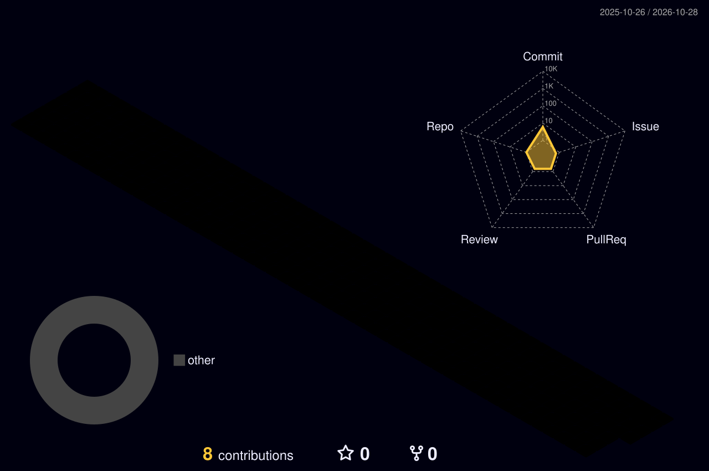

<!--
  ╔══════════════════════════════════════════════════════════════╗
  ║  Denis Boshnjaku — GitHub profile README                     ║
  ║  If your GitHub username is not "DenisBoshnjaku", find &     ║
  ║  replace it below (case-sensitive) so the live cards load.   ║
  ╚══════════════════════════════════════════════════════════════╝
-->

<p align="center">
  
</p>

<p align="center">
  <a href="mailto:denis.boshnjaku@kreatx.com"></a>
  <a href="https://github.com/DenisBoshnjaku?tab=followers"></a>
  
</p>

<p align="center">
  
</p>



<p align="center">
  
</p>


<h2 align="center">⚡ The Stack I Ship With</h2>

<p align="center">
  
</p>

<p align="center">
  
</p>

<table align="center">
<tr>
<td width="50%" valign="top">

```tsx
// whoami.tsx
const Denis = () => {
  const [coffee, setCoffee] = useState(Infinity);

  return (
    <Developer
      company="Kreatx"
      frontend={["React", "TypeScript"]}
      backend={["Java", ".NET", "PHP"]}
      motto="Make it work, make it right,
             make it fast."
    />
  );
};
```

</td>
<td width="50%" valign="top">

```java
// CurrentFocus.java
@Service
public class CurrentFocus {

  List<String> building = List.of(
    "Scalable full-stack web apps",
    "Clean REST APIs (Spring / ASP.NET / Laravel)"
  );

  List<String> learning = List.of(
    "Cloud & Docker", "System design"
  );
}
```

</td>
</tr>
</table>

<details>
<summary align="center"><b>🔍 Open the full skill tree</b></summary>
<br/>

| ⚛️ Frontend | ☕ Java | 🟣 .NET | 🐘 PHP | 🗄️ Data & Tools |
|:--|:--|:--|:--|:--|
| React · Hooks | Java 17+ | C# | PHP 8 | MySQL |
| Redux · Router | Spring Boot | ASP.NET Core | Laravel | PostgreSQL |
| TypeScript | Spring Security | Web API · MVC | Eloquent ORM | SQL Server |
| HTML5 · CSS3 | Hibernate / JPA | Entity Framework | Blade | Docker · Git |
| Tailwind | Maven | LINQ | Composer | Postman · JWT |

</details>


<h2 align="center">🏙️ My Contributions, in 3D</h2>

<p align="center">
  
</p>

<h2 align="center">📈 Live Stats</h2>

<p align="center">
  
  
  
</p>

<p align="center">
  
</p>

<h2 align="center">🐍 Watch the Snake Eat My Commits</h2>

<p align="center">
  <picture>
    <source media="(prefers-color-scheme: dark)" srcset="https://raw.githubusercontent.com/DenisBoshnjaku/DenisBoshnjaku/output/github-snake-dark.svg"/>
    <source media="(prefers-color-scheme: light)" srcset="https://raw.githubusercontent.com/DenisBoshnjaku/DenisBoshnjaku/output/github-snake.svg"/>
    
  </picture>
</p>


<p align="center">
  
</p>

<p align="center">
  <a href="mailto:denis.boshnjaku@kreatx.com">
    
  </a>
</p>

<p align="center">
  
</p>
